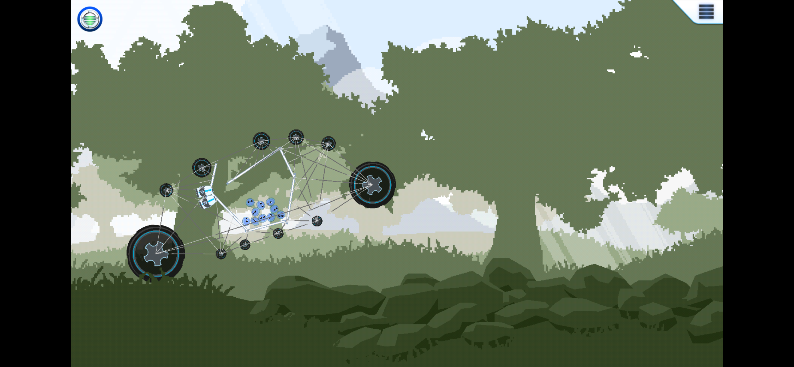
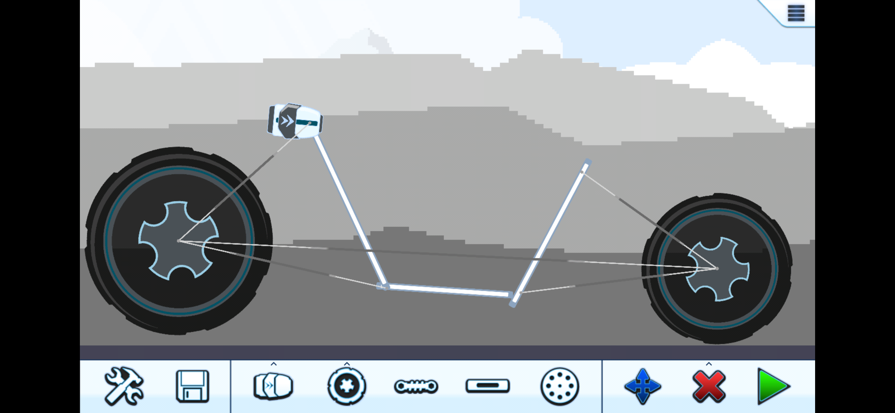
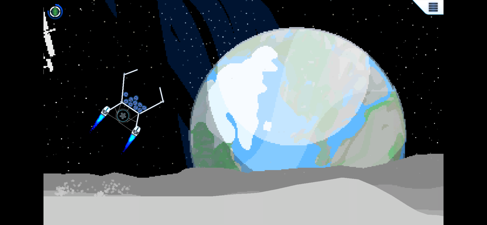
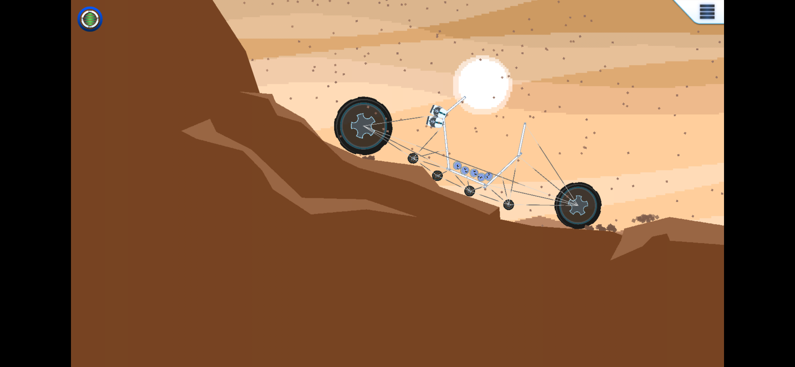

# Project Peon

Project Peon is a physics construction and driving game. Build your own cart from wheels, motors, boosters, beams and springs, then test it across Earth, the Moon and Mars. Keep your passengers aboard, reach the ship, and refine your design when things fall apart.

Originally developed for iPad, the game has been updated for macOS, iPhone and iPad with a 16:9 game view, refreshed menus and platform-specific controls.

## Features

- Build and edit custom carts, then save and load your creations.
- Explore three planets with different terrain and physics challenges.
- Use keyboard and mouse controls on Mac, or touch and tilt controls on iPhone and iPad.
- Move the touch boost button to a comfortable position.
- Pan the camera while building to inspect the course.
- Play offline without an account. All motor and booster upgrades are included.

## Gameplay

### Build a cart

### Boost across the Moon

### Drive on Mars

These screenshots show the iPhone version. The Mac version uses the same game artwork and widescreen presentation, with keyboard and mouse controls.

## Source and builds

| Platform | Branch | Build instructions |
| --- | --- | --- |
| macOS | [MacOS](https://github.com/david-a-campbell/ProjectPeon/tree/MacOS) | [Mac guide](https://github.com/david-a-campbell/ProjectPeon/blob/MacOS/mac/README.md) |
| iPhone / iPad | [iphone-release](https://github.com/david-a-campbell/ProjectPeon/tree/iphone-release) | [iOS guide](https://github.com/david-a-campbell/ProjectPeon/blob/iphone-release/ios/README.md) |

The game is built with Objective-C and C++, cocos2d, and Box2D. Version 2.0 has been submitted to Apple for review on macOS and iOS.

## Credits

Design: Daniel Campbell  
Programming: David Campbell  
Audio and menu music: Juan Sajche  
Game music: W1NGY

Copyright 2013 Digital Fury. All rights reserved.
